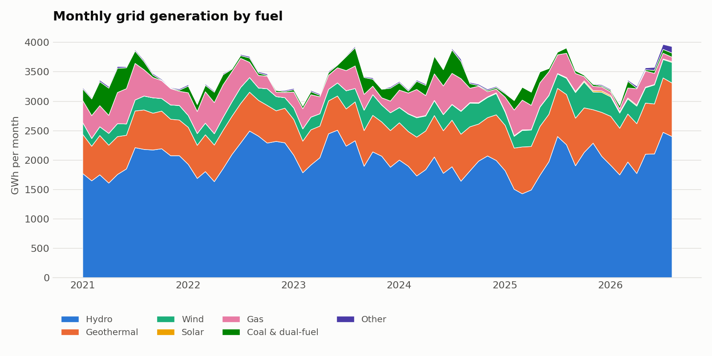
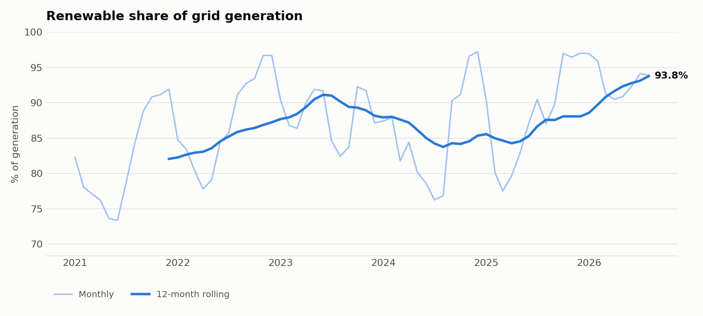
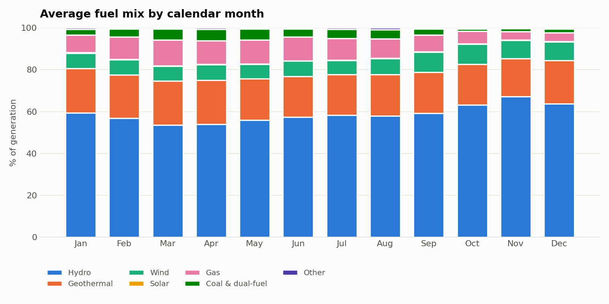
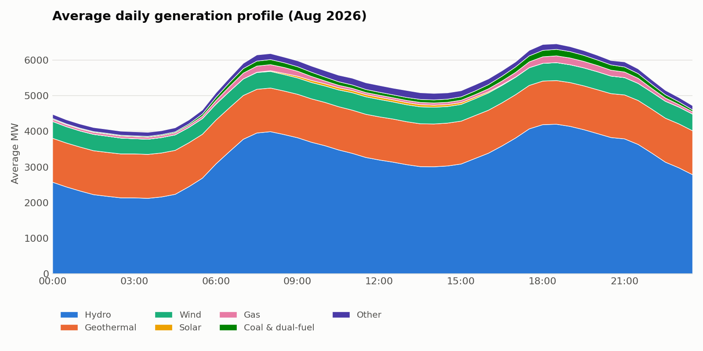

# How renewable is New Zealand's grid?


I wanted to know how much of New Zealand's electricity really comes from renewables, and whether that number is actually going up or just moving with the weather. So I pulled five and a half years of metered, half-hourly generation data from the Electricity Authority and worked through it in Python.

**Short answer:** over January 2021 – August 2026, **87.0%** of grid generation was renewable. The 12-month rolling share has climbed from **82.1%** to **93.8%**, the highest in the period. Rain still decides the good and bad years, but the climb comes from new geothermal and wind, not just a few wet winters.

| | |
|---|---|
| Period analysed | Jan 2021 – Aug 2026 (68 months) |
| Total grid generation | 232.3 TWh |
| Renewable share | 87.0% |
| Largest source | Hydro, 58.6% |
| Most renewable month | Dec 2024 – 97.2% |
| Least renewable month | Jun 2021 – 73.4% |

---

## 1. Hydro carries the system, and it's the part that swings



Hydro produced well over half of everything, but its output moves a lot: annual hydro ranged from 22.7 TWh (2024) to 25.4 TWh (2023). Because total demand barely changes from year to year (around 41 TWh every year), any shortfall in hydro has to be filled by something else. Historically, that's been gas and coal.

The clearest example is **winter 2024**. June–August hydro was only 5.3 TWh, compared with 6.3–7.1 TWh in every other winter. Coal and the dual-fuel Huntly units produced 967 GWh that winter, their highest of the period. July 2024 dropped to 76.3% renewable.

## 2. The trend is real once you strip out the seasons



The monthly line (light blue) jumps around by 20 points within a year, so I added a 12-month rolling average (dark blue) to see the underlying direction.

| Year | Renewable share |
|---|---|
| 2021 | 82.1% |
| 2022 | 87.2% |
| 2023 | 88.2% |
| 2024 | 85.3% (dry winter) |
| 2025 | 88.1% |
| 2026 (Jan–Aug) | 93.2% |

2026 only covers January to August, so it isn't a full year. To make the comparison fair, I compared January–August 2026 with January–August 2025. 2026 is still about 8 points ahead. Gas over those eight months fell from 3.1 TWh to 1.2 TWh.

Two things changed underneath the weather:

- **Geothermal grew from 7.6 TWh (2021) to 9.2 TWh (2025)**, up 22%. Its share went from 18.5% to 24.6% in 2026 so far. It runs flat out day and night, so every new MW displaces thermal generation almost directly.
- **Wind grew from 2.5 TWh to 3.7 TWh** (+48%), with a clear step up from 2024.

Grid-scale **solar** first shows up in the data in January 2024. It had reached 156 GWh by 2025, but that's still under 0.5% of grid generation.

## 3. The dirtiest time of year isn't winter, it's autumn



I expected thermal generation to peak in mid-winter, when demand is highest. It doesn't. Averaged across all years, **gas's share peaks in March (12.3%)** and coal and dual-fuel peak in **April (5.6%)**. My reading is that by late summer the hydro lakes have been drawn down and the winter rain hasn't arrived yet.

The cleanest stretch is **October to December**, when hydro reaches 63–67% of the mix. I'd guess that's spring snowmelt and rain refilling the lakes. I haven't tested that against lake-level data yet.

## 4. Hydro does the daily balancing



On an average August 2026 day, demand peaks twice: around 08:00 (~6,100 MW) and around 18:30 (~6,400 MW). Geothermal sits flat at about 1,200 MW the whole time. Hydro does the balancing, roughly doubling from ~2,100 MW overnight to ~4,200 MW at the evening peak. Gas and coal are only thin slivers, even at peak. Solar barely registers in winter.

This is why New Zealand can run at 90%+ renewable when other grids can't: its main renewable source can be turned up and down to follow demand.

---

## Open question: the rise in "Other"

The "Other" group (diesel, wood, and any fuel code I haven't mapped) was 30–40 GWh a month at most until 2025. It then rose to **110 GWh in August 2026**. The daily profile shows it running roughly flat all day. That doesn't look like solar or batteries, which would peak at midday and in the evening.

Anything in "Other" except wood counts as **non-renewable** in this analysis. If this turns out to be a new renewable fuel code, the 2026 renewable share is slightly *understated*. I'm checking which raw fuel codes make up the increase:

```python
import pandas as pd, glob
df = pd.concat(pd.read_csv(f, usecols=["Fuel_Code", "Gen_Code"]) for f in glob.glob("data/raw/2026*_Generation_MD.csv"))
print(df.drop_duplicates().groupby("Fuel_Code")["Gen_Code"].unique())
```

## Limitations

- **Grid-metered generation only.** Most rooftop solar and small embedded generation aren't in this dataset, so solar's real contribution is bigger than shown.
- **Dual-fuel units.** Huntly's Rankine units can burn gas or coal and are reported under a combined code, so gas and coal can't be fully separated.
- **Generation, not consumption.** Shares are of energy generated, not energy used.
- **Correlation, not cause.** I've connected the 2024 dip to low hydro output and the autumn thermal peak to lake drawdown. Confirming either would need lake storage and inflow data, which I haven't added yet.

## What I'd do next

1. Add hydro lake storage data to separate weather effects from structural change properly.
2. Join wholesale spot prices (EMI `Final_pricing`) to see how much a dry winter costs.
3. Estimate emissions intensity (tCO₂/MWh) by year using standard fuel emission factors.
4. Identify which new geothermal and wind stations account for the growth since 2021.

---

## Data

**Source:** Electricity Authority, Electricity Market Information (EMI): [Generation_MD dataset](https://www.emi.ea.govt.nz/Wholesale/Datasets/Generation/Generation_MD). There is one CSV per month, with one row per generating unit per trading day. Each row has 48 half-hourly kWh columns (TP1–TP48), plus TP49/TP50 on daylight-saving change days.

| EMI `Fuel_Code` | Group | Renewable |
|---|---|---|
| Hydro | Hydro | ✓ |
| Geo | Geothermal | ✓ |
| Wind | Wind | ✓ |
| Solar | Solar | ✓ |
| Wood | Other (biomass cogeneration) | ✓ |
| Gas | Gas | |
| Coal, Gas&Coal | Coal & dual-fuel (Huntly Rankine units) | |
| Diesel, unmapped codes | Other | |

## How it works

1. **Download** monthly files from EMI, skipping any already on disk (`src/nzelec/download.py`).
2. **Load** each file and sum every trading period, including daylight-saving extras, into daily GWh per fuel (`load.py`).
3. **Analyse** with pure functions, DataFrame in and DataFrame out (`analysis.py`): monthly mix, monthly and yearly renewable share, 12-month rolling share, average mix by calendar month, and average half-hourly profile.
4. **Output** CSVs to [`outputs/tables/`](outputs/tables) and charts to [`outputs/figures/`](outputs/figures).

The analysis is covered by unit tests run on synthetic data in the same format. They check that energy totals are conserved through the pipeline, that daylight-saving days (50 half-hours instead of 48) are counted, that fuel codes are classified correctly, and that percentages stay within bounds. CI runs them on every push.

## Run it yourself

```bash
git clone https://github.com/JayKayOT6/NZ-Electricity-Analysis.git
cd nz-electricity-analysis
python -m venv .venv && source .venv/bin/activate   # Windows: .venv\Scripts\activate
pip install -r requirements.txt

python run_analysis.py --start 2021-01 --end 2026-08   # reproduces this README
python run_analysis.py                                 # last 36 complete months
python run_analysis.py --skip-download                 # reuse files in data/raw/
pytest                                                 # run the tests
```

```
run_analysis.py          download → analyse → tables + charts
src/nzelec/
  download.py            fetch monthly EMI files
  load.py                parse raw files, fuel grouping
  analysis.py            summary tables (pure functions)
  plots.py               charts
tests/
  make_sample.py         synthetic EMI-format data for tests only
  test_analysis.py
```
